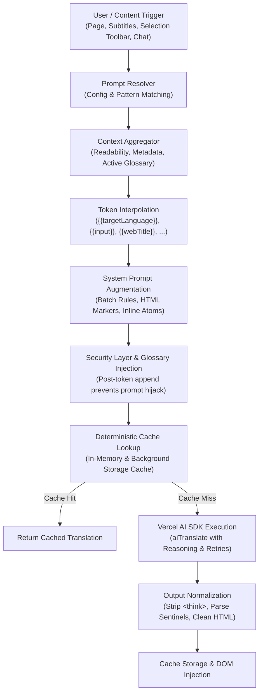

# Workmate AI

The all-in-one AI Browser Assistant & Language Companion.<br/>
Chat smarter on Telegram, Zalo, and Slack with AI auto-replies, draft winning Upwork proposals, navigate tabs in a blazing-fast Sider-style sidepanel, translate web pages and video subtitles, and learn vocabulary with FSRS flashcards.<br/>
Supercharge your productivity and language mastery directly inside your browser.

[![English][english-shield]](./README.md) [![Tiếng Việt][vietnamese-shield]](./readmes/README.vi.md)

[Official Website](https://www.readfrog.app/en?utm_source=github&utm_medium=readme&utm_campaign=read-frog&utm_content=en) · [All Features](https://www.readfrog.app/en/features?utm_source=github&utm_medium=readme&utm_campaign=read-frog&utm_content=en) · [Tutorial](https://www.readfrog.app/en/docs?utm_source=github&utm_medium=readme&utm_campaign=read-frog&utm_content=en) · [Changelog][github-release-link] · [Blog](https://www.readfrog.app/en/blog?utm_source=github&utm_medium=readme&utm_campaign=read-frog&utm_content=en)

</div>

<details>
<summary><kbd>Table of contents</kbd></summary>

#### TOC

- [👋🏻 Getting Started](#-getting-started)
  - [Download](#download)
  - [Tech Stack](#tech-stack)
- [✨ Key Features](#-key-features)
  - [💬 AI Web Chat Assistant (Telegram, Zalo, Slack)](#-ai-web-chat-assistant)
  - [💼 Upwork Copilot & Proposal Writer](#-upwork-copilot--proposal-writer)
  - [⚡ Sider-Style Instant Sidepanel](#-sider-style-instant-sidepanel)
  - [🪄 Custom AI Actions](#-custom-ai-actions)
  - [🧠 Flashcards \& Spaced Repetition (FSRS)](#-flashcards--spaced-repetition)
  - [🔄 Bilingual / Translation Only](#-bilingual--translation-only)
  - [✨ Selection Translation Toolbar](#-selection-translation)
  - [🎬 Video Subtitle Translation (YouTube & Netflix)](#-subtitle-translation)
  - [🔊 Text-to-Speech (TTS)](#-text-to-speech-tts)
  - [📦 Batch Requests & Cost Optimization](#-batch-requests)
  - [🤖 20+ AI Providers](#-20-ai-providers)
- [🧩 Prompt Processing Workflow & Architecture](#-prompt-processing-workflow--architecture)
  - [Architecture Overview](#architecture-overview)
  - [Prompt Pipeline Lifecycle](#prompt-pipeline-lifecycle)
  - [Developer Guide: Adding a New Prompt](#developer-guide-adding-a-new-prompt)
- [💻 Development & Contributing](#-development--contributing)
- [📜 License](#-license)
- [📜 Commercial License Grant](#-commercial-license-grant)
- [❤️ Sponsors](#️-sponsors)

<br/>

</details>

## 👋🏻 Getting Started

Workmate AI empowers you to read, write, research, and communicate effortlessly on the web. Connect your favorite LLMs (OpenAI, Claude, Gemini, DeepSeek, Groq, Ollama) and enjoy an integrated workspace right in your browser.

### Tech Stack

- **Extension Framework**: [WXT](https://wxt.dev/) with Vite
- **UI & Components**: React 19, Tailwind CSS v4, `@base-ui/react`, Radix UI slots
- **State & Storage**: Jotai, TanStack React Store, WXT Storage
- **Code Quality**: Oxlint (`oxlint`), Oxfmt (`oxfmt`), Vitest (`vitest`)
- **Package Manager**: `pnpm`

### Download

| Browser | Version                                                                | Download                                                          |
| ------- | ---------------------------------------------------------------------- | ----------------------------------------------------------------- |
| Chrome  | [![Chrome Version badge][chrome-version-shield]][chrome-store-link]    | [Chrome Web Store][chrome-store-link] or [中国镜像][crxsoso-link] |
| Edge    | [![Edge Version badge][edge-version-shield]][edge-store-link]          | [Microsoft Edge Addons][edge-store-link]                          |
| Firefox | [![Firefox Version badge][firefox-version-shield]][firefox-store-link] | [Firefox Add-ons][firefox-store-link]                             |

<div align="right">

[![Back to top][back-to-top]](#readme-top)

</div>

## ✨ Key Features

Transform your browser into a powerhouse for communication, research, and language mastery.

### 💬 AI Web Chat Assistant

Accelerate your conversations on **Telegram Web (A & K)**, **Zalo Web**, **Slack**, and popular web messengers.

- **Smart Auto Reply & Auto Draft**: Instantly generates contextual reply suggestions. Auto-draft places suggestions directly into your input box, while auto-send delivers responses hands-free.
- **Adaptive Tone & Style**: Switch dynamically between _Professional_, _Casual_, _Concise_, _Friendly_, or _Humorous_ tones.
- **PII Redaction & Privacy**: Automatically masks emails, phone numbers, and sensitive client information before sending context to AI models.
- **Sidepanel Auto Reply Toggle**: Easily enable or disable background auto-reply triggers directly from the Sidepanel Header Toolbar.

<div align="right">

[![Back to top][back-to-top]](#readme-top)

</div>

### 💼 Upwork Copilot & Proposal Writer

Win more freelance contracts in less time with an integrated assistant designed for Upwork freelancers.

- **Job Post Deep Dive**: Analyzes client requirements, budget constraints, deliverables, and red flags.
- **Screening Question Generator**: Crafts precise, personalized answers to tricky application questions.
- **Custom Cover Letter Drafting**: Generates compelling, non-templated proposals highlighting your relevant skills and portfolio matches.

<div align="right">

[![Back to top][back-to-top]](#readme-top)

</div>

### ⚡ Sider-Style Instant Sidepanel

A lightweight, multi-tab sidepanel inspired by Sider that loads in milliseconds (<100ms):

- **Tabs**: `Chat` (Conversational AI), `WebChat` (Live messaging copilot), `Read` (Page summarizer & reader), `Write` (Content composer), and `Translate` (Direct bilingual translator).
- **Code-Split & Optimized**: Built with lazy-loaded views, instant store rehydration, and zero static AI SDK bloat on initial launch.
- **Theme Aware**: Supports light and dark modes with customizable accent themes.

<div align="right">

[![Back to top][back-to-top]](#readme-top)

</div>

### 🪄 [Custom AI Actions][docs-custom-actions]

Turn selected text into reusable AI tools that match the way you read and learn. Define your own prompts and structured output fields, choose a provider, model, and icon, then run the action directly from the selection toolbar for dictionary lookups, rewriting, summaries, explanations, or any workflow you design.

Start with the built-in **Dictionary** and **Improve Writing** templates, or build an action from scratch. Structured results can also be mapped and saved to Notebase for later study.

<div align="right">

[![Back to top][back-to-top]](#readme-top)

</div>

### 🧠 [Flashcards & Spaced Repetition][docs-learning]

Save vocabulary, definitions, example sentences, translations, and reading notes to Notebase, then turn them into flashcards with customizable card templates. Content you discover while reading becomes study material without interrupting your flow.

Review due cards online and rate each one **Again**, **Hard**, **Good**, or **Easy**. Workmate AI's spaced-repetition scheduler uses your feedback to decide when each card should appear again—right before you are likely to forget it.

<div align="right">

[![Back to top][back-to-top]](#readme-top)

</div>

<!-- ![][image-feat-bilingual] -->

### 🔄 [Bilingual / Translation Only][docs-page-translation]

Switch seamlessly between two translation display modes. **Bilingual mode** shows the original text alongside its translation, perfect for learning and comparison. **Translation-only mode** replaces the original text entirely for a cleaner reading experience.

The extension automatically re-translates all visible content when you switch modes while translation is active, ensuring a smooth transition without needing to refresh the page.

<div align="right">

[![Back to top][back-to-top]](#readme-top)

</div>

<!-- ![][image-feat-selection] -->

### ✨ [Selection Translation][docs-selection-translation]

Select any text on a webpage to reveal a smart toolbar with powerful options. **Translate** streams the translation in real-time. **Explain** provides detailed explanations tailored to your language level. **Speak** reads the text aloud using text-to-speech.

The toolbar intelligently positions itself to stay within the viewport, supports drag interactions, and works across all websites. Perfect for quick lookups while reading.

<div align="right">

[![Back to top][back-to-top]](#readme-top)

</div>

<!-- ![][image-feat-context] -->

### 🧠 [Context-Aware Translation][blog-context-translation]

Enable AI to understand the full context of what you're reading. When activated, Workmate AI extracts the page title and a concise Markdown version of the page content, providing this context to the AI for more accurate, contextually-appropriate translations.

This means technical terms get translated correctly within their domain, literary expressions maintain their nuance, and ambiguous phrases are interpreted based on the surrounding content rather than in isolation.

<div align="right">

[![Back to top][back-to-top]](#readme-top)

</div>

<!-- ![][image-feat-subtitle] -->

### 🎬 [Subtitle Translation][video-subtitles]

Translate subtitles on YouTube, X, and Netflix right in the video player. The translation appears with the original line, in sync with the video. For YouTube videos without captions, AI can transcribe the audio and show the result as the same bilingual subtitles (included in Pro and Ultra). Select any word in the subtitles to look it up and save it for review.

<div align="right">

[![Back to top][back-to-top]](#readme-top)

</div>

<!-- ![][image-feat-tts] -->

### 🔊 [Text-to-Speech (TTS)][docs-tts]

Listen to any selected text with high-quality AI voices. It is completely free, with 300+ voices across 70+ languages including Chinese, English, Japanese, Korean, and many more. Adjust rate, pitch, and volume to your preference.

Automatic language detection (basic or LLM-powered) with per-language voice mapping ensures the right voice for every language. Smart sentence-aware chunking handles long text by splitting at natural boundaries and prefetching the next chunk for seamless playback. Perfect for pronunciation practice and auditory learning.

<div align="right">

[![Back to top][back-to-top]](#readme-top)

</div>

<!-- ![][image-feat-batch] -->

### 📦 [Batch Requests][docs-request-control]

Save up to 70% on API costs with intelligent request batching. Workmate AI groups multiple translation requests into single API calls, reducing overhead and token usage while maintaining translation quality.

The system includes smart retry logic with exponential backoff and automatic fallback to individual requests if batch processing fails. All handled transparently in the background.

<div align="right">

[![Back to top][back-to-top]](#readme-top)

</div>

<!-- ![][image-feat-providers] -->

### 🤖 [20+ AI Providers][docs-providers]

Connect to 20+ AI providers through Vercel AI SDK: OpenAI, DeepSeek, Anthropic Claude, Google Gemini, xAI Grok, Groq, Mistral, Ollama, and many more. Configure custom endpoints, API keys, and model settings for each provider.

Plus free translation options: Google Translate, Microsoft Translate, and DeepLX for cost-free basic translations.

<div align="right">

[![Back to top][back-to-top]](#readme-top)

</div>

## 🧩 Prompt Processing Workflow & Architecture

Workmate AI uses a multi-stage prompt processing pipeline to assemble contextual prompts, protect DOM markers and mathematical atoms, dynamically inject glossary terms, and interface with LLM providers through the Vercel AI SDK.

### Architecture Overview



---

### Prompt Pipeline Lifecycle

The prompt lifecycle consists of 6 sequential phases designed for reliability, prompt injection safety, and caching efficiency:

1. **Trigger & Resolution**
   - Translation requests invoke [`getTranslatePrompt`](./src/utils/prompts/translate.ts) (for web pages and selections) or [`getSubtitlesTranslatePrompt`](./src/utils/prompts/subtitles.ts) (for video subtitles).
   - The resolver evaluates the configured prompt ID in order of priority:
     - Built-in prompt registry (`BUILT_IN_PAGE_TRANSLATE_PROMPTS` or `BUILT_IN_SUBTITLE_TRANSLATE_PROMPTS` in [`src/utils/constants/prompt.ts`](./src/utils/constants/prompt.ts)).
     - User custom patterns configured in Options.
     - Default prompt fallback (`DEFAULT_TRANSLATE_PROMPT_ID`).

2. **Context Aggregation**
   - Webpage metadata is gathered: title, description, Readability-extracted content, and AI/document summaries.
   - For video subtitles, video title, description, and summary are gathered.
   - For selection translation, the surrounding paragraph (`SelectionPromptContext`) is captured.
   - Glossary matches are searched using the Aho-Corasick algorithm against the user's active glossary.

3. **Token Interpolation**
   - Supported placeholders (e.g. `{{targetLanguage}}`, `{{input}}`, `{{webTitle}}`) are replaced with sanitized runtime values via `replaceTokens`.
   - Empty metadata fields are safely substituted with descriptive fallbacks (e.g. `"No title available"` via `resolvePromptReplacementValue`).

4. **System Prompt Augmentation & Rule Injection**
   - **Batch Translation**: In batch mode, appends batch separator instructions (`%%`) and sentinel instructions (`{{NO_TRANSLATION_NEEDED}}`).
   - **HTML Attribute Protection**: When input contains protected markers (e.g. `rf-id="..."`), injects `HTML_ATTRIBUTE_MARKER_SYSTEM_PROMPT` to enforce exact marker retention on original elements.
   - **Inline Atom Tokens**: When input contains formula/atom placeholders (e.g. `{{0}}`), appends `INLINE_ATOM_TOKEN_SYSTEM_PROMPT`.
   - **Custom Actions (Structured Output)**: For selection toolbar actions, appends `## Structured Output Contract` with a YAML field specification and rigid JSON output schema.

5. **Security Ordering & Deterministic Caching**
   - **Post-Replacement Glossary Injection**: Matched glossary terms and selection context are appended to the system prompt **after** token replacement has completed. This ensures user glossary terms containing `{{input}}` substrings cannot hijack or corrupt the prompt structure.
   - **Deterministic Cache Key**: Only terms that actually match the current segment are appended. If no terms match, the prompt remains byte-identical to a request without glossary, preventing cache-miss explosion.

6. **Execution via Vercel AI SDK & Normalization**
   - [`aiTranslate`](./src/utils/host/translate/api/ai.ts) executes `generateText` using the Vercel AI SDK with provider-specific options and temperature.
   - Reasoning tokens (e.g., `<think>...</think>` from DeepSeek-R1 or reasoning models) are automatically stripped before output parsing.
   - Sentinel markers (`{{NO_TRANSLATION_NEEDED}}`) are detected and mapped to empty strings or skipped.

---

### Supported Tokens & Context Interpolation

| Token                | Scope            | Source / Description                                            |
| :------------------- | :--------------- | :-------------------------------------------------------------- |
| `{{targetLanguage}}` | Page & Subtitles | Target language name (e.g. `English`, `Vietnamese`, `Japanese`) |
| `{{input}}`          | Page & Subtitles | Source text segment or batch text to be translated              |
| `{{webTitle}}`       | Page & Subtitles | Active document or video title                                  |
| `{{webDescription}}` | Page & Subtitles | Page `<meta name="description">` or video description           |
| `{{webContent}}`     | Page             | Main article body extracted via Readability                     |
| `{{webSummary}}`     | Page             | Document summary generated for translation context              |
| `{{videoSummary}}`   | Subtitles        | Summary of current video context                                |
| `{{selection}}`      | Custom Actions   | Exact text selected by the user on the page                     |
| `{{paragraphs}}`     | Custom Actions   | Surrounding paragraph(s) of the selection                       |
| `{{webUrl}}`         | Custom Actions   | Full URL of the active tab                                      |

---

### System Prompt Augmentation & Rule Injection

Workmate AI dynamically injects rules into the system prompt according to the features active on each segment:

```
[Base System Prompt (Built-in or Custom)]
       │
       ▼ (if isBatch)
[Batch Separator (%%) & Sentinel Rules]
       │
       ▼ (if contains HTML markers)
[Protected HTML Marker Rules (rf-id)]
       │
       ▼ (if contains inline formulas)
[Inline Atom Token Rules ({{0}})]
       │
       ▼ (Token Replacement: {{targetLanguage}}, {{webTitle}}, etc.)
       │
       ▼ (Post-Token Appends)
[Glossary Matched Terms Block]
       │
       ▼ (if selection context present)
[Surrounding Passage Block]
       │
       ▼ (if custom action with structured output)
[Structured Output JSON/YAML Contract]
```

---

### Security, Deterministic Caching & Glossary Protection

- **Prompt Injection Defense**: Glossary terms and user notes are treated as untrusted data. By appending glossary entries **after** token interpolation (`replaceTokens`), malicious or accidental `{{token}}` sequences in user glossaries can never execute token replacement.
- **Cache Conservation**: The translation cache key is computed directly from the assembled prompt and input. Injecting only _matched_ glossary terms ensures paragraphs without glossary terms hit the generic cache, drastically minimizing API consumption across repeat visits.

---

### Real-World Examples

#### Example 1: Webpage Batch Translation with Protected HTML & Glossary

**Input segment**:

```html
<p>Deploy your models using <span rf-id="1">zero-shot prompt</span> configurations.</p>
```

**Active Glossary**: `zero-shot prompt` &rarr; `câu lệnh gợi ý zero-shot`  
**Target Language**: `Vietnamese`

**Assembled System Prompt (Snippet)**:

```markdown
You are a professional Vietnamese native translator who needs to fluently translate text into Vietnamese.

## Translation Rules

1. Output only the translated content, without explanations or additional content.
2. The returned translation must maintain exactly the same number of paragraphs and format as the original text.

## Document Metadata for Context Awareness

Webpage title: Next-Gen LLM Architectures
Webpage summary: Overview of modern prompt strategies.

## Protected HTML Marker Rules

These mandatory rules override any conflicting instructions above:

1. Within each input segment, preserve every `rf-id` attribute occurrence and its value exactly once in that segment's output.
2. Never add, remove, change, duplicate, rename, renumber, or move a marker to another segment.
3. Keep each marker on its original HTML element.

## Glossary Terms

Translate the following terms accurately according to the glossary:

- "zero-shot prompt" -> "câu lệnh gợi ý zero-shot"
```

**Model Output**:

```html
<p>Triển khai mô hình của bạn bằng các cấu hình <span rf-id="1">câu lệnh gợi ý zero-shot</span>.</p>
```

---

#### Example 2: Selection Custom Action with Structured Output Contract

**Selected text**: `"Spaced repetition produces significantly better long-term retention than massed practice."`  
**Custom Action**: `Vocabulary & Analysis Extractor`  
**Configured Output Schema**:

- `keyTerm` (string): Core terminology
- `explanation` (string): Plain language definition
- `cefrLevel` (string): Estimated CEFR level (A1-C2)

**Generated System Prompt Contract**:

```markdown
Analyze the selected text for language learning.

## Structured Output Contract

Return exactly one JSON object and nothing else.

### Required Keys and Types

- key: "keyTerm"
  type: string
  nullable: true
  description: |-
  The main term or concept identified.
- key: "explanation"
  type: string
  nullable: true
  description: |-
  Clear explanation in {{targetLanguage}}.
- key: "cefrLevel"
  type: string
  nullable: true
  description: |-
  Estimated CEFR level (A1, A2, B1, B2, C1, C2).

### Hard Requirements

1. Include every required key exactly once.
2. Do not add any extra keys.
3. Use the exact key names shown above.
4. Output valid JSON only. Use double quotes for keys and string values.
5. Do not wrap the JSON in markdown or code fences.
6. If a value is unknown, use null.
```

**Parsed Result in UI**:

```json
{
  "keyTerm": "Spaced repetition",
  "explanation": "Phương pháp lặp lại ngắt quãng giúp ghi nhớ dài hạn hiệu quả.",
  "cefrLevel": "B2"
}
```

---

#### Example 3: Subtitle Translation with Video Context Awareness

**Video Metadata**: Title `"MIT 6.S191: Convolutional Neural Networks"`, Summary `"Lecture covering feature maps, pooling layers, and kernels."`  
**Subtitle Cue**: `"Here we apply a 3x3 kernel across the feature map."`  
**Target Language**: `Japanese`

**User Prompt**:

```
Translate to Japanese:

Here we apply a 3x3 kernel across the feature map.
```

**Assembled Result**:
Because the video summary contextualizes the terminology as computer vision / machine learning, the LLM translates `"kernel"` as `カーネル` and `"feature map"` as `特徴マップ` (rather than culinary or generic interpretations), preserving natural subtitle timing length.

---

### Developer Guide: Adding a New Prompt

To add a new built-in translation prompt or custom prompt preset:

1. **Define the Prompt Constants**  
   In [`src/utils/constants/prompt.ts`](./src/utils/constants/prompt.ts), add your system prompt and user prompt definitions:

   ```typescript
   export const MY_NEW_TRANSLATE_PROMPT_ID = "myNewPrompt"

   export const MY_NEW_TRANSLATE_SYSTEM_PROMPT = `You are a specialist translator...`
   export const MY_NEW_TRANSLATE_PROMPT = `Translate to {{targetLanguage}}:\n\n{{input}}`
   ```

2. **Register in Built-In Registry**  
   Add the prompt definition to `BUILT_IN_PAGE_TRANSLATE_PROMPTS` or `BUILT_IN_SUBTITLE_TRANSLATE_PROMPTS`:

   ```typescript
   export const BUILT_IN_PAGE_TRANSLATE_PROMPTS = {
     [DEFAULT_TRANSLATE_PROMPT_ID]: { ... },
     [MY_NEW_TRANSLATE_PROMPT_ID]: {
       id: MY_NEW_TRANSLATE_PROMPT_ID,
       systemPrompt: MY_NEW_TRANSLATE_SYSTEM_PROMPT,
       prompt: MY_NEW_TRANSLATE_PROMPT,
     },
   }
   ```

3. **Provide Localization Copies**  
   In [`src/components/prompt-configurator/built-in-prompts.ts`](./src/components/prompt-configurator/built-in-prompts.ts), register the prompt name and description in `getBuiltInPromptCopy`:

   ```typescript
   case MY_NEW_TRANSLATE_PROMPT_ID:
     return {
       name: i18n.t("options.translation.personalizedPrompts.builtInPrompts.myNewPrompt.name"),
       description: i18n.t("options.translation.personalizedPrompts.builtInPrompts.myNewPrompt.description"),
     }
   ```

4. **Add Unit Tests**  
   Verify token interpolation and prompt assembly by adding tests in [`src/utils/constants/__tests__/prompt.test.ts`](./src/utils/constants/__tests__/prompt.test.ts) and [`src/utils/prompts/__tests__/translate.test.ts`](./src/utils/prompts/__tests__/translate.test.ts).

<div align="right">

[![Back to top][back-to-top]](#readme-top)

</div>

## 💻 Development & Contributing

### Prerequisites

- Node.js >= 20
- [pnpm](https://pnpm.io/) >= 9 (strictly required)

### Local Development Setup

1. **Clone the repository**:

   ```bash
   git clone https://github.com/mengxi-ream/read-frog.git
   cd read-frog
   ```

2. **Install dependencies**:

   ```bash
   pnpm install
   ```

3. **Start the development server**:
   ```bash
   pnpm dev
   ```
   Loads the extension into Chrome via WXT. For other browsers:
   ```bash
   pnpm dev:edge
   pnpm dev:firefox
   ```

### Code Quality & Testing

- **Linting & Type-checking**:
  ```bash
  pnpm lint
  ```
- **Formatting**:
  ```bash
  pnpm fmt:check
  pnpm fmt
  ```
- **Run Unit Tests**:

  ```bash
  SKIP_FREE_API=true pnpm test --run
  ```

  _(Note: `SKIP_FREE_API=true` skips external rate-limited translation API calls during local testing)._

- **Build Production Bundles**:
  ```bash
  pnpm build
  # Or analyze bundle size:
  pnpm build:analyze
  ```

<div align="right">

[![Back to top][back-to-top]](#readme-top)

</div>

## 📜 Commercial License Grant

 **Meituan Tabbit Browser Team**: Free license (at no cost) for closed-source commercial use, limited to v1.21.3 and earlier versions (commit [`724863f`](https://github.com/mengxi-ream/read-frog/commit/724863fdbc2d777766cada6c111235534ee03ca0)). Granted on March 3, 2026, 9:00 AM (Vancouver Time, UTC-8).

<div align="right">

[![Back to top][back-to-top]](#readme-top)

</div>

## ❤️ Sponsors

Every donation helps us build a better language learning experience. Thank you for supporting our mission!

[![Sponsors][sponsor-image]][sponsor-link]

<a href="https://ifapi.org/?aff=readfrog&utm_source=readfrog&utm_medium=readme">
  
</a>

<div align="right">

[![Back to top][back-to-top]](#readme-top)

</div>

<!-- LINK GROUP -->

[back-to-top]: https://img.shields.io/badge/-BACK_TO_TOP-151515?style=flat-square
[chrome-store-link]: https://chromewebstore.google.com/detail/read-frog-open-source-ai/modkelfkcfjpgbfmnbnllalkiogfofhb
[chrome-users-shield]: https://img.shields.io/chrome-web-store/users/modkelfkcfjpgbfmnbnllalkiogfofhb?style=flat-square&label=Chrome%20Users&color=yellow&labelColor=black
[chrome-version-shield]: https://img.shields.io/chrome-web-store/v/modkelfkcfjpgbfmnbnllalkiogfofhb?style=flat-square&label=Chrome%20Version&labelColor=black&color=yellow
[contributors-link]: https://github.com/mengxi-ream/read-frog/graphs/contributors
[contributors-shield]: https://img.shields.io/github/contributors/mengxi-ream/read-frog?style=flat-square&labelColor=black
[crxsoso-link]: https://www.crxsoso.com/webstore/detail/modkelfkcfjpgbfmnbnllalkiogfofhb
[chinese-shield]: https://img.shields.io/badge/%E7%AE%80%E4%BD%93%E4%B8%AD%E6%96%87-gray?style=flat-square
[discord-link]: https://discord.gg/ej45e3PezJ
[discord-shield]: https://img.shields.io/discord/1371229720942874646?style=flat-square&label=Discord&logo=discord&logoColor=white&color=5865F2&labelColor=black
[discord-shield-badge]: https://img.shields.io/badge/chat-Discord-5865F2?style=for-the-badge&logo=discord&logoColor=white&labelColor=black
[edge-store-link]: https://microsoftedge.microsoft.com/addons/detail/read-frog-open-source-a/cbcbomlgikfbdnoaohcjfledcoklcjbo
[english-shield]: https://img.shields.io/badge/English-gray?style=flat-square
[firefox-store-link]: https://addons.mozilla.org/firefox/addon/read-frog-open-ai-translator/
[firefox-version-shield]: https://img.shields.io/amo/v/read-frog-open-ai-translator?style=flat-square&label=Firefox%20Version&labelColor=black&color=orange
[firefox-users-shield]: https://img.shields.io/amo/users/read-frog-open-ai-translator?style=flat-square&label=Firefox%20Users&color=orange&labelColor=black
[edge-users-shield]: https://img.shields.io/badge/dynamic/json?style=flat-square&logo=microsoft-edge&label=Edge%20Users&query=%24.activeInstallCount&url=https%3A%2F%2Fmicrosoftedge.microsoft.com%2Faddons%2Fgetproductdetailsbycrxid%2Fcbcbomlgikfbdnoaohcjfledcoklcjbo&labelColor=black
[edge-version-shield]: https://img.shields.io/badge/dynamic/json?style=flat-square&logo=microsoft-edge&label=Edge%20Version&query=%24.version&url=https%3A%2F%2Fmicrosoftedge.microsoft.com%2Faddons%2Fgetproductdetailsbycrxid%2Fcbcbomlgikfbdnoaohcjfledcoklcjbo&labelColor=black&prefix=v
[extension-release-shield]: https://img.shields.io/github/package-json/v/mengxi-ream/read-frog?filename=package.json&style=flat-square&label=Latest%20Version&color=brightgreen&labelColor=black
[github-release-link]: https://github.com/mengxi-ream/read-frog/releases
[github-star-link]: https://github.com/mengxi-ream/read-frog/stargazers
[image-banner]: /assets/banner.png
[image-star]: ./assets/star.png
[issues-link]: https://github.com/mengxi-ream/read-frog/issues
[issues-shield]: https://img.shields.io/github/issues/mengxi-ream/read-frog?style=flat-square&labelColor=black
[japanese-shield]: https://img.shields.io/badge/%E6%97%A5%E6%9C%AC%E8%AA%9E-gray?style=flat-square
[korean-shield]: https://img.shields.io/badge/%ED%95%9C%EA%B5%AD%EC%96%B4-gray?style=flat-square
[last-commit-shield]: https://img.shields.io/github/last-commit/mengxi-ream/read-frog?style=flat-square&label=commit&labelColor=black
[russian-shield]: https://img.shields.io/badge/%D0%A0%D1%83%D1%81%D1%81%D0%BA%D0%B8%D0%B9-gray?style=flat-square
[sponsor-image]: https://cdn.jsdelivr.net/gh/mengxi-ream/static/sponsorkit/sponsors.svg
[sponsor-link]: https://github.com/sponsors/mengxi-ream
[sponsor-shield]: https://img.shields.io/github/sponsors/mengxi-ream?style=flat-square&label=Sponsor&color=EA4AAA&labelColor=black
[spanish-shield]: https://img.shields.io/badge/Espa%C3%B1ol-gray?style=flat-square
[star-history-link]: https://www.star-history.com/#mengxi-ream/read-frog&Timeline
[star-history-shield]: https://img.shields.io/github/stars/mengxi-ream/read-frog?style=flat-square&label=stars&color=yellow&labelColor=black
[traditional-chinese-shield]: https://img.shields.io/badge/%E7%B9%81%E9%AB%94%E4%B8%AD%E6%96%87-gray?style=flat-square
[turkish-shield]: https://img.shields.io/badge/T%C3%BCrk%C3%A7e-gray?style=flat-square
[vietnamese-shield]: https://img.shields.io/badge/Ti%E1%BA%BFng%20Vi%E1%BB%87t-gray?style=flat-square
[website]: https://www.readfrog.app/en?utm_source=github&utm_medium=readme&utm_campaign=read-frog&utm_content=en
[wechat-link]: ./assets/wechat-account.jpg
[wechat-shield-badge]: https://img.shields.io/badge/chat-WeChat-07C160?style=for-the-badge&logo=wechat&logoColor=white&labelColor=black

<!-- Feature links -->

[blog-context-translation]: https://www.readfrog.app/en/blog/smart-context-translation?utm_source=github&utm_medium=readme&utm_campaign=read-frog&utm_content=en
[docs-custom-actions]: https://www.readfrog.app/en/docs/custom-actions?utm_source=github&utm_medium=readme&utm_campaign=read-frog&utm_content=en
[docs-learning]: https://www.readfrog.app/en/docs/learning?utm_source=github&utm_medium=readme&utm_campaign=read-frog&utm_content=en
[docs-page-translation]: https://www.readfrog.app/en/docs/page-translation?utm_source=github&utm_medium=readme&utm_campaign=read-frog&utm_content=en
[docs-providers]: https://www.readfrog.app/en/docs/providers/overview?utm_source=github&utm_medium=readme&utm_campaign=read-frog&utm_content=en
[docs-request-control]: https://www.readfrog.app/en/docs/request-control?utm_source=github&utm_medium=readme&utm_campaign=read-frog&utm_content=en
[docs-selection-translation]: https://www.readfrog.app/en/docs/selection-translation?utm_source=github&utm_medium=readme&utm_campaign=read-frog&utm_content=en
[docs-tts]: https://www.readfrog.app/en/docs/tts?utm_source=github&utm_medium=readme&utm_campaign=read-frog&utm_content=en
[video-subtitles]: https://www.readfrog.app/en/features/youtube-subtitles?utm_source=github&utm_medium=readme&utm_campaign=read-frog&utm_content=en
