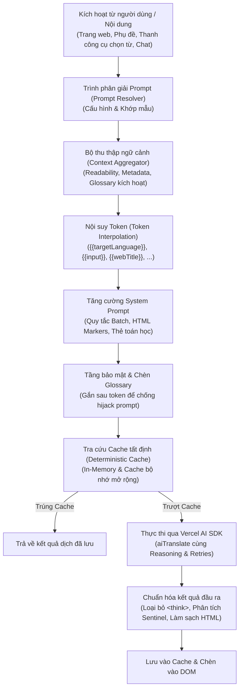

<div align="center"><a name="readme-top"></a>

[![Workmate AI banner][image-banner]][website]

<p align="center">
  <a href="https://trendshift.io/repositories/22377" target="_blank"></a>
  <a href="https://www.star-history.com/mengxi-ream/read-frog">
    <picture>
      <source media="(prefers-color-scheme: dark)" srcset="https://api.star-history.com/badge?repo=mengxi-ream/read-frog&theme=dark" />
      <source media="(prefers-color-scheme: light)" srcset="https://api.star-history.com/badge?repo=mengxi-ream/read-frog" />
      
    </picture>
  </a>
</p>

Tiện ích mở rộng trình duyệt giúp học ngôn ngữ bằng AI, và là lựa chọn thay thế mã nguồn mở cho Immersive Translate.<br/>
Dịch trang web, câu bạn chọn và phụ đề trên YouTube, X và Netflix. Sau đó lưu từ mới và ôn tập bằng flashcard theo lịch FSRS.<br/>
Học ngôn ngữ dễ hơn và sâu hơn ngay trong trình duyệt của bạn.

[![English][english-shield]](../README.md) [![Tiếng Việt][vietnamese-shield]](./README.vi.md)

[Trang chính thức](https://www.readfrog.app/vi?utm_source=github&utm_medium=readme&utm_campaign=read-frog&utm_content=vi) · [Tất cả tính năng](https://www.readfrog.app/vi/features?utm_source=github&utm_medium=readme&utm_campaign=read-frog&utm_content=vi) · [Hướng dẫn](https://www.readfrog.app/vi/docs?utm_source=github&utm_medium=readme&utm_campaign=read-frog&utm_content=vi) · [Nhật ký phát hành][github-release-link] · [Blog](https://www.readfrog.app/vi/blog?utm_source=github&utm_medium=readme&utm_campaign=read-frog&utm_content=vi) · [vs Immersive Translate (tiếng Anh)](https://www.readfrog.app/en/compare/immersive-translate?utm_source=github&utm_medium=readme&utm_campaign=read-frog&utm_content=vi)

<!-- SHIELD GROUP -->

[![Latest Version badge][extension-release-shield]][github-release-link]
[![Chrome Version badge][chrome-version-shield]][chrome-store-link]
[![Edge Version badge][edge-version-shield]][edge-store-link]
[![Firefox Version badge][firefox-version-shield]][firefox-store-link]<br/>
[![Discord badge][discord-shield]][discord-link]
[![Chrome Users badge][chrome-users-shield]][chrome-store-link]
[![Edge Users badge][edge-users-shield]][edge-store-link]
[![Firefox Users badge][firefox-users-shield]][firefox-store-link]<br/>
[![Stars badge][star-history-shield]][star-history-link]
[![Contributors badge][contributors-shield]][contributors-link]
![Last Commit badge][last-commit-shield]
[![Issues badge][issues-shield]][issues-link]<br/>
[![Sponsor badge][sponsor-shield]][sponsor-link]

</div>

<details>
<summary><kbd>Mục lục</kbd></summary>

#### Mục lục

- [📺 Demo](#-demo)
- [👋🏻 Bắt đầu và tham gia cộng đồng](#-bắt-đầu-và-tham-gia-cộng-đồng)
  - [Tải xuống](#tải-xuống)
  - [Cộng đồng](#cộng-đồng)
- [✨ Tính năng](#-tính-năng)
  - [🪄 Hành động AI tùy chỉnh](#-hành-động-ai-tùy-chỉnh)
  - [🧠 Thẻ ghi nhớ và lặp lại ngắt quãng](#-thẻ-ghi-nhớ-và-lặp-lại-ngắt-quãng)
  - [🔄 Song ngữ / Chỉ bản dịch](#-song-ngữ--chỉ-bản-dịch)
  - [✨ Dịch văn bản đã chọn](#-dịch-văn-bản-đã-chọn)
  - [🧠 Dịch theo ngữ cảnh](#-dịch-theo-ngữ-cảnh)
  - [🎬 Dịch phụ đề](#-dịch-phụ-đề)
  - [🔊 Chuyển văn bản thành giọng nói (TTS)](#-chuyển-văn-bản-thành-giọng-nói-tts)
  - [📦 Yêu cầu theo lô](#-yêu-cầu-theo-lô)
  - [🤖 Hơn 20 nhà cung cấp AI](#-hơn-20-nhà-cung-cấp-ai)
- [🧩 Quy trình & Kiến trúc xử lý Prompt](#-quy-trình--kiến-trúc-xử-lý-prompt)
  - [Tổng quan kiến trúc](#tổng-quan-kiến-trúc)
  - [Vòng đời pipeline xử lý prompt](#vòng-đời-pipeline-xử-lý-prompt)
  - [Các Token hỗ trợ & Nội suy ngữ cảnh](#các-token-hỗ-trợ--nội-suy-ngữ-cảnh)
  - [Tăng cường System Prompt & Chèn quy tắc](#tăng-cường-system-prompt--chèn-quy-tắc)
  - [Bảo mật, Caching tất định & Bảo vệ Glossary](#bảo-mật-caching-tất-định--bảo-vệ-glossary)
  - [Các ví dụ thực tế](#các-ví-dụ-thực-tế)
  - [Hướng dẫn cho lập trình viên: Thêm prompt mới](#hướng-dẫn-cho-lập-trình-viên-thêm-prompt-mới)
- [🤝 Đóng góp](#-đóng-góp)
- [📜 Cấp phép thương mại](#-cấp-phép-thương-mại)
- [❤️ Nhà tài trợ](#️-nhà-tài-trợ)

<br/>

</details>

## 📺 Demo

🔊 Trình phát mặc định tắt tiếng, hãy bật âm thanh.

https://github.com/user-attachments/assets/c000c3e7-40af-4621-8a7f-72a685732c31

## 👋🏻 Bắt đầu và tham gia cộng đồng

Tầm nhìn của Workmate AI là mang đến trải nghiệm học ngôn ngữ dễ dùng, thông minh và cá nhân hóa cho người học ở mọi trình độ. Trong thời đại AI, điều này đã trở nên khả thi, nhưng vẫn chưa có nhiều sản phẩm đáp ứng tốt nhu cầu đó. Vì vậy chúng tôi quyết định tự xây dựng.

Dù bạn là người dùng hay nhà phát triển, Workmate AI có thể là một phần quan trọng trong hành trình này. Dự án đang được phát triển tích cực, và mọi phản hồi hoặc [vấn đề][issues-link] đều được hoan nghênh.

### Tải xuống

| Trình duyệt | Phiên bản                                                              | Tải xuống                                                                    |
| ----------- | ---------------------------------------------------------------------- | ---------------------------------------------------------------------------- |
| Chrome      | [![Chrome Version badge][chrome-version-shield]][chrome-store-link]    | [Chrome Web Store][chrome-store-link] hoặc [mirror Trung Quốc][crxsoso-link] |
| Edge        | [![Edge Version badge][edge-version-shield]][edge-store-link]          | [Microsoft Edge Addons][edge-store-link]                                     |
| Firefox     | [![Firefox Version badge][firefox-version-shield]][firefox-store-link] | [Firefox Add-ons][firefox-store-link]                                        |

### Cộng đồng

| [![Discord badge][discord-shield-badge]][discord-link] | Đặt câu hỏi và kết nối với nhà phát triển trên Discord.             |
| :----------------------------------------------------- | :------------------------------------------------------------------ |
| [![WeChat badge][wechat-shield-badge]][wechat-link]    | Nếu bạn ở Trung Quốc đại lục, bạn cũng có thể tham gia nhóm WeChat. |

> \[!IMPORTANT]
>
> **⭐️ Hãy star dự án**, bạn sẽ nhận thông báo phát hành từ GitHub mà không bị chậm trễ.

[![Star Workmate AI on GitHub][image-star]][github-star-link]

<details>
<summary>
  <kbd>Lịch sử star</kbd>
</summary>

<a href="https://www.star-history.com/?type=timeline&repos=mengxi-ream%2Fread-frog">
 <picture>
   <source media="(prefers-color-scheme: dark)" srcset="https://api.star-history.com/chart?repos=mengxi-ream/read-frog&type=timeline&theme=dark&legend=top-left&sealed_token=vUW24BwE2sgnq-CzlWEAT6gnzZqNrXl9ai4A05Pc3CQcPGdBqbts3tq5VRWEerfrqVdonsJasb04WcKd5AKSSCjlsdj_TwyI3j9xytMG4FQNw7yXDe9IUA" />
   <source media="(prefers-color-scheme: light)" srcset="https://api.star-history.com/chart?repos=mengxi-ream/read-frog&type=timeline&legend=top-left&sealed_token=vUW24BwE2sgnq-CzlWEAT6gnzZqNrXl9ai4A05Pc3CQcPGdBqbts3tq5VRWEerfrqVdonsJasb04WcKd5AKSSCjlsdj_TwyI3j9xytMG4FQNw7yXDe9IUA" />
   
 </picture>
</a>

</details>

## ✨ Tính năng

Biến việc đọc web hằng ngày thành trải nghiệm học ngôn ngữ nhập vai với các tính năng của Workmate AI.

### 🪄 [Hành động AI tùy chỉnh][docs-custom-actions]

Biến văn bản đã chọn thành công cụ AI có thể tái sử dụng, phù hợp với cách bạn đọc và học. Tự định nghĩa prompt và các trường đầu ra có cấu trúc, chọn nhà cung cấp, mô hình và biểu tượng, rồi chạy tác vụ ngay từ thanh công cụ để tra từ, viết lại, tóm tắt, giải thích hoặc thực hiện quy trình riêng.

Bắt đầu với mẫu **Từ điển** và **Cải thiện bài viết** có sẵn, hoặc tạo tác vụ từ đầu. Bạn cũng có thể ánh xạ và lưu kết quả có cấu trúc vào Notebase để học sau.

### 🧠 [Thẻ ghi nhớ và lặp lại ngắt quãng][docs-learning]

Lưu từ vựng, định nghĩa, câu ví dụ, bản dịch và ghi chú đọc vào Notebase, sau đó biến chúng thành thẻ ghi nhớ bằng các mẫu thẻ có thể tùy chỉnh. Nội dung bạn bắt gặp khi đọc trở thành tài liệu học mà không làm gián đoạn mạch đọc.

Ôn các thẻ đến hạn trực tuyến và đánh giá từng thẻ là **Lại**, **Khó**, **Tốt** hoặc **Dễ**. Bộ lập lịch lặp lại ngắt quãng của Workmate AI dùng phản hồi này để đưa mỗi thẻ trở lại ngay trước khi bạn có thể quên.

### 🔄 [Song ngữ / Chỉ bản dịch][docs-page-translation]

Chuyển đổi mượt mà giữa hai chế độ hiển thị bản dịch. **Chế độ song ngữ** hiển thị văn bản gốc cùng bản dịch, phù hợp để học và so sánh. **Chỉ bản dịch** thay thế văn bản gốc để trải nghiệm đọc gọn gàng hơn.

Khi đang dịch, việc đổi chế độ sẽ tự động dịch lại toàn bộ nội dung đang hiển thị mà không cần tải lại trang.

### ✨ [Dịch văn bản đã chọn][docs-selection-translation]

Chọn bất kỳ đoạn văn bản nào trên trang để mở thanh công cụ thông minh. **Dịch** hiển thị kết quả theo thời gian thực, **Giải thích** đưa ra phần giải thích phù hợp với trình độ của bạn, còn **Đọc** phát âm văn bản bằng TTS.

Thanh công cụ tự đặt vị trí trong khung nhìn, hỗ trợ kéo thả và hoạt động trên mọi website.

### 🧠 [Dịch theo ngữ cảnh][blog-context-translation]

Cho phép AI hiểu đầy đủ ngữ cảnh của nội dung bạn đang đọc. Workmate AI trích xuất tiêu đề trang và phiên bản Markdown ngắn gọn của nội dung để AI tạo bản dịch chính xác và phù hợp ngữ cảnh hơn.

Thuật ngữ kỹ thuật được dịch đúng trong lĩnh vực của nó, cách diễn đạt văn học giữ được sắc thái, còn những cụm từ mơ hồ được hiểu dựa trên nội dung xung quanh.

### 🎬 [Dịch phụ đề][video-subtitles]

Dịch phụ đề YouTube, X và Netflix ngay trong trình phát video. Bản dịch hiển thị cùng dòng phụ đề gốc và khớp theo video. Với video YouTube không có phụ đề, AI có thể chép lời từ âm thanh rồi hiển thị thành phụ đề song ngữ như trên (có trong gói Pro và Ultra). Chọn bất kỳ từ nào trong phụ đề để tra nghĩa và lưu lại để ôn tập.

### 🔊 [Chuyển văn bản thành giọng nói (TTS)][docs-tts]

Nghe văn bản đã chọn bằng giọng AI chất lượng cao. Hoàn toàn miễn phí, có hơn 300 giọng trên hơn 70 ngôn ngữ, gồm tiếng Trung, tiếng Anh, tiếng Nhật, tiếng Hàn và nhiều ngôn ngữ khác. Bạn có thể chỉnh tốc độ, cao độ và âm lượng.

Tự động phát hiện ngôn ngữ và ánh xạ giọng nói theo từng ngôn ngữ giúp chọn đúng giọng. Văn bản dài được chia theo ranh giới câu tự nhiên và tải trước đoạn tiếp theo để phát mượt mà.

### 📦 [Yêu cầu theo lô][docs-request-control]

Tiết kiệm tới 70% chi phí API bằng cách gom yêu cầu thông minh. Workmate AI nhóm nhiều yêu cầu dịch thành một lệnh gọi API duy nhất, giảm overhead và lượng token sử dụng mà vẫn giữ chất lượng dịch.

Hệ thống có cơ chế retry với exponential backoff và tự động fallback về yêu cầu riêng lẻ nếu xử lý theo lô thất bại.

### 🤖 [Hơn 20 nhà cung cấp AI][docs-providers]

Kết nối với hơn 20 nhà cung cấp AI qua Vercel AI SDK: OpenAI, DeepSeek, Anthropic Claude, Google Gemini, xAI Grok, Groq, Mistral, Ollama và nhiều hơn nữa. Bạn có thể cấu hình endpoint, API key và model cho từng nhà cung cấp.

Ngoài ra còn có các lựa chọn dịch miễn phí như Google Translate, Microsoft Translate và DeepLX cho nhu cầu dịch cơ bản.

<div align="right">

[![Back to top][back-to-top]](#readme-top)

</div>

## 🧩 Quy trình & Kiến trúc xử lý Prompt

Workmate AI áp dụng pipeline xử lý prompt đa tầng để lắp ghép các prompt giàu ngữ cảnh, bảo toàn thẻ định danh DOM và công thức toán học, tự động chèn thuật ngữ glossary tương ứng, đồng thời tương tác với các nhà cung cấp LLM thông qua Vercel AI SDK.

### Tổng quan kiến trúc



---

### Vòng đời pipeline xử lý prompt

Vòng đời của một prompt bao gồm 6 giai đoạn tuần tự nhằm đảm bảo độ tin cậy, chống tấn công prompt injection và tối ưu hóa bộ nhớ đệm:

1. **Kích hoạt & Phân giải (Trigger & Resolution)**
   - Yêu cầu dịch sẽ gọi hàm [`getTranslatePrompt`](file:///Users/huuha/dev/extensions/workmate-ai/src/utils/prompts/translate.ts) (cho trang web và vùng chọn) hoặc [`getSubtitlesTranslatePrompt`](file:///Users/huuha/dev/extensions/workmate-ai/src/utils/prompts/subtitles.ts) (cho phụ đề video).
   - Trình phân giải kiểm tra ID prompt theo thứ tự ưu tiên:
     - Registry prompt tích hợp sẵn (`BUILT_IN_PAGE_TRANSLATE_PROMPTS` hoặc `BUILT_IN_SUBTITLE_TRANSLATE_PROMPTS` trong [`src/utils/constants/prompt.ts`](file:///Users/huuha/dev/extensions/workmate-ai/src/utils/constants/prompt.ts)).
     - Các mẫu prompt do người dùng tự tạo trong Cài đặt (Options).
     - Prompt mặc định của hệ thống (`DEFAULT_TRANSLATE_PROMPT_ID`).

2. **Thu thập ngữ cảnh (Context Aggregation)**
   - Thu thập thông tin trang: tiêu đề, mô tả, nội dung trích xuất bằng Readability và bản tóm tắt nội dung.
   - Đối với phụ đề video, trích xuất tiêu đề video, mô tả và tóm tắt video.
   - Đối với dịch vùng chọn, trích xuất đoạn văn bao quanh (`SelectionPromptContext`).
   - Tìm kiếm các thuật ngữ glossary xuất hiện trong đoạn văn bản bằng thuật toán Aho-Corasick.

3. **Nội suy Token (Token Interpolation)**
   - Các biến giữ chỗ (như `{{targetLanguage}}`, `{{input}}`, `{{webTitle}}`) được thay thế bằng dữ liệu thực thi đã qua làm sạch qua hàm `replaceTokens`.
   - Nếu metadata bị thiếu, hệ thống tự động điền giá trị dự phòng an toàn (ví dụ `"No title available"` qua `resolvePromptReplacementValue`).

4. **Tăng cường System Prompt & Chèn quy tắc**
   - **Dịch theo lô (Batch Translation)**: Khi ở chế độ batch, tự động bổ sung hướng dẫn phân tách dấu phân đoạn (`%%`) và quy tắc sentinel (`{{NO_TRANSLATION_NEEDED}}`).
   - **Bảo vệ thuộc tính HTML**: Khi văn bản chứa thẻ đánh dấu (như `rf-id="..."`), hệ thống tự động chèn `HTML_ATTRIBUTE_MARKER_SYSTEM_PROMPT` nhằm yêu cầu LLM giữ nguyên vị trí thuộc tính trên phần tử HTML gốc.
   - **Thẻ nguyên tử toán học (Inline Atoms)**: Khi văn bản có công thức (ví dụ `{{0}}`), chèn `INLINE_ATOM_TOKEN_SYSTEM_PROMPT`.
   - **Hành động tùy chỉnh (Structured Output)**: Đối với các action trên thanh công cụ chọn từ, chèn `## Structured Output Contract` với định dạng trường YAML và ràng buộc JSON chặt chẽ.

5. **Thứ tự bảo mật & Caching tất định**
   - **Gắn Glossary sau khi thay token**: Các thuật ngữ glossary và ngữ cảnh đoạn văn luôn được nối vào system prompt **sau** khi đã hoàn tất việc thay thế token. Điều này ngăn chặn việc người dùng nhập thuật ngữ chứa chuỗi dạng `{{input}}` gây phá vỡ hoặc chiếm quyền điều khiển prompt.
   - **Khóa Cache tất định**: Chỉ những thuật ngữ glossary thực sự xuất hiện trong đoạn văn mới được đưa vào prompt. Nếu không có thuật ngữ nào khớp, prompt sẽ giống hệt như khi không bật glossary, từ đó tối đa hóa tỷ lệ trúng cache giữa các trang và người dùng khác nhau.

6. **Thực thi qua Vercel AI SDK & Chuẩn hóa**
   - [`aiTranslate`](file:///Users/huuha/dev/extensions/workmate-ai/src/utils/host/translate/api/ai.ts) kích hoạt `generateText` thông qua Vercel AI SDK cùng các tùy chọn model và nhiệt độ (temperature).
   - Tự động cắt bỏ các token suy luận (như khối `<think>...</think>` của DeepSeek-R1 hoặc các mô hình reasoning).
   - Phát hiện dấu hiệu sentinel (`{{NO_TRANSLATION_NEEDED}}`) để chuyển đổi thành chuỗi rỗng hoặc bỏ qua dịch đoạn văn bản trùng ngôn ngữ đích.

---

### Các Token hỗ trợ & Nội suy ngữ cảnh

| Token                | Phạm vi            | Mô tả / Nguồn gốc                                             |
| :------------------- | :----------------- | :------------------------------------------------------------ |
| `{{targetLanguage}}` | Trang web & Phụ đề | Tên ngôn ngữ đích (ví dụ `Tiếng Việt`, `English`, `Japanese`) |
| `{{input}}`          | Trang web & Phụ đề | Đoạn văn bản hoặc nhóm văn bản đầu vào cần dịch               |
| `{{webTitle}}`       | Trang web & Phụ đề | Tiêu đề trang web hiện tại hoặc tiêu đề video                 |
| `{{webDescription}}` | Trang web & Phụ đề | Thẻ mô tả `<meta name="description">` hoặc mô tả video        |
| `{{webContent}}`     | Trang web          | Nội dung bài viết chính được lọc qua Readability              |
| `{{webSummary}}`     | Trang web          | Bản tóm tắt trang web được tạo để làm ngữ cảnh dịch           |
| `{{videoSummary}}`   | Phụ đề             | Bản tóm tắt nội dung video                                    |
| `{{selection}}`      | Hành động AI       | Văn bản chính xác được bôi đen                                |
| `{{paragraphs}}`     | Hành động AI       | Đoạn văn xung quanh phần văn bản được bôi đen                 |
| `{{webUrl}}`         | Hành động AI       | URL đầy đủ của trang web đang mở                              |

---

### Tăng cường System Prompt & Chèn quy tắc

Workmate AI linh hoạt ghép thêm các quy tắc vào System Prompt tùy theo đặc tính của từng đoạn nội dung:

```
[System Prompt cơ sở (Tích hợp sẵn hoặc Người dùng tạo)]
       │
       ▼ (nếu ở chế độ batch)
[Quy tắc phân tách đoạn (%%) & Quy tắc Sentinel]
       │
       ▼ (nếu chứa thẻ HTML có id)
[Quy tắc bảo vệ thuộc tính HTML (rf-id)]
       │
       ▼ (nếu chứa công thức toán học)
[Quy tắc bảo toàn Inline Atoms ({{0}})]
       │
       ▼ (Nội suy Token: {{targetLanguage}}, {{webTitle}}, v.v.)
       │
       ▼ (Giai đoạn gắn thêm sau khi thay token)
[Khối thuật ngữ Glossary khớp thực tế]
       │
       ▼ (nếu có ngữ cảnh đoạn văn được chọn)
[Khối đoạn văn bản bao quanh]
       │
       ▼ (nếu là hành động tùy chỉnh yêu cầu cấu trúc)
[Hợp đồng đầu ra có cấu trúc JSON/YAML Contract]
```

---

### Bảo mật, Caching tất định & Bảo vệ Glossary

- **Chống tấn công Prompt Injection**: Các mục trong từ điển người dùng được xem là dữ liệu không tin cậy. Nhờ việc chỉ ghép glossary vào **sau** khi thay thế token, các chuỗi độc hại dạng `{{token}}` trong từ điển của người dùng sẽ không bao giờ được thực thi nội suy.
- **Tiết kiệm tài nguyên Cache**: Khóa cache dịch được tạo trực tiếp từ mã băm của prompt hoàn chỉnh và văn bản đầu vào. Việc chỉ chèn các thuật ngữ glossary thực sự xuất hiện trong câu giúp các câu không chứa thuật ngữ vẫn trúng cache chung, giảm đáng kể chi phí gọi API.

---

### Các ví dụ thực tế

#### Ví dụ 1: Dịch trang web theo lô có bảo toàn thẻ HTML & Glossary

**Đoạn văn bản đầu vào**:

```html
<p>Deploy your models using <span rf-id="1">zero-shot prompt</span> configurations.</p>
```

**Thuật ngữ Glossary kích hoạt**: `zero-shot prompt` &rarr; `câu lệnh gợi ý zero-shot`  
**Ngôn ngữ đích**: `Vietnamese`

**System Prompt được ghép (trích đoạn)**:

```markdown
You are a professional Vietnamese native translator who needs to fluently translate text into Vietnamese.

## Translation Rules

1. Output only the translated content, without explanations or additional content.
2. The returned translation must maintain exactly the same number of paragraphs and format as the original text.

## Document Metadata for Context Awareness

Webpage title: Next-Gen LLM Architectures
Webpage summary: Overview of modern prompt strategies.

## Protected HTML Marker Rules

These mandatory rules override any conflicting instructions above:

1. Within each input segment, preserve every `rf-id` attribute occurrence and its value exactly once in that segment's output.
2. Never add, remove, change, duplicate, rename, renumber, or move a marker to another segment.
3. Keep each marker on its original HTML element.

## Glossary Terms

Translate the following terms accurately according to the glossary:

- "zero-shot prompt" -> "câu lệnh gợi ý zero-shot"
```

**Kết quả mô hình trả về**:

```html
<p>Triển khai mô hình của bạn bằng các cấu hình <span rf-id="1">câu lệnh gợi ý zero-shot</span>.</p>
```

---

#### Ví dụ 2: Hành động AI trên vùng chọn với Structured Output Contract

**Văn bản được chọn**: `"Spaced repetition produces significantly better long-term retention than massed practice."`  
**Hành động AI**: `Trích xuất từ vựng & Phân tích`  
**Cấu hình lược đồ đầu ra (Schema)**:

- `keyTerm` (string): Thuật ngữ trọng tâm
- `explanation` (string): Giải thích bằng ngôn ngữ đích
- `cefrLevel` (string): Ước tính trình độ CEFR (A1-C2)

**System Prompt Contract được tự động sinh ra**:

```markdown
Analyze the selected text for language learning.

## Structured Output Contract

Return exactly one JSON object and nothing else.

### Required Keys and Types

- key: "keyTerm"
  type: string
  nullable: true
  description: |-
  The main term or concept identified.
- key: "explanation"
  type: string
  nullable: true
  description: |-
  Clear explanation in {{targetLanguage}}.
- key: "cefrLevel"
  type: string
  nullable: true
  description: |-
  Estimated CEFR level (A1, A2, B1, B2, C1, C2).

### Hard Requirements

1. Include every required key exactly once.
2. Do not add any extra keys.
3. Use the exact key names shown above.
4. Output valid JSON only. Use double quotes for keys and string values.
5. Do not wrap the JSON in markdown or code fences.
6. If a value is unknown, use null.
```

**Kết quả JSON nhận được và hiển thị trên giao diện**:

```json
{
  "keyTerm": "Spaced repetition",
  "explanation": "Phương pháp lặp lại ngắt quãng giúp ghi nhớ dài hạn hiệu quả.",
  "cefrLevel": "B2"
}
```

---

#### Ví dụ 3: Dịch phụ đề có ngữ cảnh video

**Metadata của video**: Tiêu đề `"MIT 6.S191: Convolutional Neural Networks"`, Tóm tắt `"Lecture covering feature maps, pooling layers, and kernels."`  
**Câu phụ đề gốc**: `"Here we apply a 3x3 kernel across the feature map."`  
**Ngôn ngữ đích**: `Tiếng Nhật`

**Prompt gửi tới mô hình**:

```
Translate to Japanese:

Here we apply a 3x3 kernel across the feature map.
```

**Kết quả sau xử lý**:
Nhờ có tóm tắt ngữ cảnh video về học sâu/thị giác máy tính, mô hình nhận biết chính xác từ `"kernel"` phải dịch là `カーネル` và `"feature map"` là `特徴マップ` (thay vì các nghĩa thông dụng như hạt nhân ngô hoặc bản đồ địa lý), đồng thời giữ độ dài tương đương để đồng bộ nhịp hiển thị phụ đề.

---

### Hướng dẫn cho lập trình viên: Thêm prompt mới

Để thêm một prompt dịch tích hợp sẵn hoặc tạo preset prompt mới:

1. **Định nghĩa hằng số Prompt**  
   Trong file [`src/utils/constants/prompt.ts`](file:///Users/huuha/dev/extensions/workmate-ai/src/utils/constants/prompt.ts), khai báo System Prompt và User Prompt:

   ```typescript
   export const MY_NEW_TRANSLATE_PROMPT_ID = "myNewPrompt"

   export const MY_NEW_TRANSLATE_SYSTEM_PROMPT = `You are a specialist translator...`
   export const MY_NEW_TRANSLATE_PROMPT = `Translate to {{targetLanguage}}:\n\n{{input}}`
   ```

2. **Đăng ký vào Built-In Registry**  
   Thêm định nghĩa prompt vào `BUILT_IN_PAGE_TRANSLATE_PROMPTS` hoặc `BUILT_IN_SUBTITLE_TRANSLATE_PROMPTS`:

   ```typescript
   export const BUILT_IN_PAGE_TRANSLATE_PROMPTS = {
     [DEFAULT_TRANSLATE_PROMPT_ID]: { ... },
     [MY_NEW_TRANSLATE_PROMPT_ID]: {
       id: MY_NEW_TRANSLATE_PROMPT_ID,
       systemPrompt: MY_NEW_TRANSLATE_SYSTEM_PROMPT,
       prompt: MY_NEW_TRANSLATE_PROMPT,
     },
   }
   ```

3. **Cung cấp bản dịch hiển thị tên & mô tả**  
   Trong [`src/components/prompt-configurator/built-in-prompts.ts`](file:///Users/huuha/dev/extensions/workmate-ai/src/components/prompt-configurator/built-in-prompts.ts), thêm case xử lý i18n trong hàm `getBuiltInPromptCopy`:

   ```typescript
   case MY_NEW_TRANSLATE_PROMPT_ID:
     return {
       name: i18n.t("options.translation.personalizedPrompts.builtInPrompts.myNewPrompt.name"),
       description: i18n.t("options.translation.personalizedPrompts.builtInPrompts.myNewPrompt.description"),
     }
   ```

4. **Thêm Unit Test kiểm thử**  
   Bảo đảm cơ chế nội suy token và ghép prompt hoạt động ổn định bằng cách thêm test trong [`src/utils/constants/__tests__/prompt.test.ts`](file:///Users/huuha/dev/extensions/workmate-ai/src/utils/constants/__tests__/prompt.test.ts) và [`src/utils/prompts/__tests__/translate.test.ts`](file:///Users/huuha/dev/extensions/workmate-ai/src/utils/prompts/__tests__/translate.test.ts).

<div align="right">

[![Back to top][back-to-top]](#readme-top)

</div>

## 🤝 Đóng góp

Mọi hình thức đóng góp đều được hoan nghênh.

1. Giới thiệu Workmate AI cho bạn bè và gia đình.
2. Báo cáo [issue][issues-link] và gửi phản hồi.
3. Đóng góp mã nguồn.

### Đóng góp mã nguồn

Cấu trúc dự án: [DeepWiki](https://deepwiki.com/mengxi-ream/read-frog)

Yêu cầu AI hiểu dự án: [Dosu](https://app.dosu.dev/29569286-71ba-47dd-b038-c7ab1b9d0df7/documents)

Xem [Hướng dẫn đóng góp](https://www.readfrog.app/vi/docs/contributing?utm_source=github&utm_medium=readme&utm_campaign=read-frog&utm_content=vi) để biết thêm chi tiết.

ReadFrog được cấp phép kép theo GPLv3 và giấy phép thương mại.

Điều khoản cấp phép cho người đóng góp nằm trong [CONTRIBUTING.md](../CONTRIBUTING.md).

<a href="https://github.com/mengxi-ream/read-frog/graphs/contributors">
  <table>
    <tr>
      <th colspan="2">
        <br>
        <br>
        <br>
      </th>
    </tr>
  </table>
</a>

## 📜 Cấp phép thương mại

 **Meituan Tabbit Browser Team**: giấy phép miễn phí cho sử dụng thương mại mã nguồn đóng, giới hạn ở v1.21.3 và các phiên bản trước đó (commit [`724863f`](https://github.com/mengxi-ream/read-frog/commit/724863fdbc2d777766cada6c111235534ee03ca0)). Được cấp vào 9:00 sáng ngày 3 tháng 3 năm 2026, giờ Vancouver (UTC-8).

## ❤️ Nhà tài trợ

Mỗi khoản đóng góp giúp chúng tôi xây dựng trải nghiệm học ngôn ngữ tốt hơn. Cảm ơn bạn đã ủng hộ sứ mệnh của chúng tôi.

[![Sponsors][sponsor-image]][sponsor-link]

<a href="https://ifapi.org/?aff=readfrog&utm_source=readfrog&utm_medium=readme">
  
</a>

<div align="right">

[![Back to top][back-to-top]](#readme-top)

</div>

<!-- LINK GROUP -->

[back-to-top]: https://img.shields.io/badge/-BACK_TO_TOP-151515?style=flat-square
[chrome-store-link]: https://chromewebstore.google.com/detail/read-frog-open-source-ai/modkelfkcfjpgbfmnbnllalkiogfofhb
[chrome-users-shield]: https://img.shields.io/chrome-web-store/users/modkelfkcfjpgbfmnbnllalkiogfofhb?style=flat-square&label=Chrome%20Users&color=yellow&labelColor=black
[chrome-version-shield]: https://img.shields.io/chrome-web-store/v/modkelfkcfjpgbfmnbnllalkiogfofhb?style=flat-square&label=Chrome%20Version&labelColor=black&color=yellow
[contributors-link]: https://github.com/mengxi-ream/read-frog/graphs/contributors
[contributors-shield]: https://img.shields.io/github/contributors/mengxi-ream/read-frog?style=flat-square&labelColor=black
[crxsoso-link]: https://www.crxsoso.com/webstore/detail/modkelfkcfjpgbfmnbnllalkiogfofhb
[chinese-shield]: https://img.shields.io/badge/%E7%AE%80%E4%BD%93%E4%B8%AD%E6%96%87-gray?style=flat-square
[discord-link]: https://discord.gg/ej45e3PezJ
[discord-shield]: https://img.shields.io/discord/1371229720942874646?style=flat-square&label=Discord&logo=discord&logoColor=white&color=5865F2&labelColor=black
[discord-shield-badge]: https://img.shields.io/badge/chat-Discord-5865F2?style=for-the-badge&logo=discord&logoColor=white&labelColor=black
[edge-store-link]: https://microsoftedge.microsoft.com/addons/detail/read-frog-open-source-a/cbcbomlgikfbdnoaohcjfledcoklcjbo
[english-shield]: https://img.shields.io/badge/English-gray?style=flat-square
[firefox-store-link]: https://addons.mozilla.org/firefox/addon/read-frog-open-ai-translator/
[firefox-version-shield]: https://img.shields.io/amo/v/read-frog-open-ai-translator?style=flat-square&label=Firefox%20Version&labelColor=black&color=orange
[firefox-users-shield]: https://img.shields.io/amo/users/read-frog-open-ai-translator?style=flat-square&label=Firefox%20Users&color=orange&labelColor=black
[edge-users-shield]: https://img.shields.io/badge/dynamic/json?style=flat-square&logo=microsoft-edge&label=Edge%20Users&query=%24.activeInstallCount&url=https%3A%2F%2Fmicrosoftedge.microsoft.com%2Faddons%2Fgetproductdetailsbycrxid%2Fcbcbomlgikfbdnoaohcjfledcoklcjbo&labelColor=black
[edge-version-shield]: https://img.shields.io/badge/dynamic/json?style=flat-square&logo=microsoft-edge&label=Edge%20Version&query=%24.version&url=https%3A%2F%2Fmicrosoftedge.microsoft.com%2Faddons%2Fgetproductdetailsbycrxid%2Fcbcbomlgikfbdnoaohcjfledcoklcjbo&labelColor=black&prefix=v
[extension-release-shield]: https://img.shields.io/github/package-json/v/mengxi-ream/read-frog?filename=package.json&style=flat-square&label=Latest%20Version&color=brightgreen&labelColor=black
[github-release-link]: https://github.com/mengxi-ream/read-frog/releases
[github-star-link]: https://github.com/mengxi-ream/read-frog/stargazers
[image-banner]: ../assets/banner.png
[image-star]: ../assets/star.png
[issues-link]: https://github.com/mengxi-ream/read-frog/issues
[issues-shield]: https://img.shields.io/github/issues/mengxi-ream/read-frog?style=flat-square&labelColor=black
[japanese-shield]: https://img.shields.io/badge/%E6%97%A5%E6%9C%AC%E8%AA%9E-gray?style=flat-square
[korean-shield]: https://img.shields.io/badge/%ED%95%9C%EA%B5%AD%EC%96%B4-gray?style=flat-square
[last-commit-shield]: https://img.shields.io/github/last-commit/mengxi-ream/read-frog?style=flat-square&label=commit&labelColor=black
[russian-shield]: https://img.shields.io/badge/%D0%A0%D1%83%D1%81%D1%81%D0%BA%D0%B8%D0%B9-gray?style=flat-square
[sponsor-image]: https://cdn.jsdelivr.net/gh/mengxi-ream/static/sponsorkit/sponsors.svg
[sponsor-link]: https://github.com/sponsors/mengxi-ream
[sponsor-shield]: https://img.shields.io/github/sponsors/mengxi-ream?style=flat-square&label=Sponsor&color=EA4AAA&labelColor=black
[spanish-shield]: https://img.shields.io/badge/Espa%C3%B1ol-gray?style=flat-square
[star-history-link]: https://www.star-history.com/#mengxi-ream/read-frog&Timeline
[star-history-shield]: https://img.shields.io/github/stars/mengxi-ream/read-frog?style=flat-square&label=stars&color=yellow&labelColor=black
[traditional-chinese-shield]: https://img.shields.io/badge/%E7%B9%81%E9%AB%94%E4%B8%AD%E6%96%87-gray?style=flat-square
[turkish-shield]: https://img.shields.io/badge/T%C3%BCrk%C3%A7e-gray?style=flat-square
[vietnamese-shield]: https://img.shields.io/badge/Ti%E1%BA%BFng%20Vi%E1%BB%87t-gray?style=flat-square
[website]: https://www.readfrog.app/vi?utm_source=github&utm_medium=readme&utm_campaign=read-frog&utm_content=vi
[wechat-link]: ../assets/wechat-account.jpg
[wechat-shield-badge]: https://img.shields.io/badge/chat-WeChat-07C160?style=for-the-badge&logo=wechat&logoColor=white&labelColor=black

<!-- Feature links -->

[blog-context-translation]: https://www.readfrog.app/vi/blog/smart-context-translation?utm_source=github&utm_medium=readme&utm_campaign=read-frog&utm_content=vi
[docs-custom-actions]: https://www.readfrog.app/vi/docs/custom-actions?utm_source=github&utm_medium=readme&utm_campaign=read-frog&utm_content=vi
[docs-learning]: https://www.readfrog.app/vi/docs/learning?utm_source=github&utm_medium=readme&utm_campaign=read-frog&utm_content=vi
[docs-page-translation]: https://www.readfrog.app/vi/docs/page-translation?utm_source=github&utm_medium=readme&utm_campaign=read-frog&utm_content=vi
[docs-providers]: https://www.readfrog.app/vi/docs/providers/overview?utm_source=github&utm_medium=readme&utm_campaign=read-frog&utm_content=vi
[docs-request-control]: https://www.readfrog.app/vi/docs/request-control?utm_source=github&utm_medium=readme&utm_campaign=read-frog&utm_content=vi
[docs-selection-translation]: https://www.readfrog.app/vi/docs/selection-translation?utm_source=github&utm_medium=readme&utm_campaign=read-frog&utm_content=vi
[docs-tts]: https://www.readfrog.app/vi/docs/tts?utm_source=github&utm_medium=readme&utm_campaign=read-frog&utm_content=vi
[video-subtitles]: https://www.readfrog.app/vi/docs/video-subtitles?utm_source=github&utm_medium=readme&utm_campaign=read-frog&utm_content=vi
